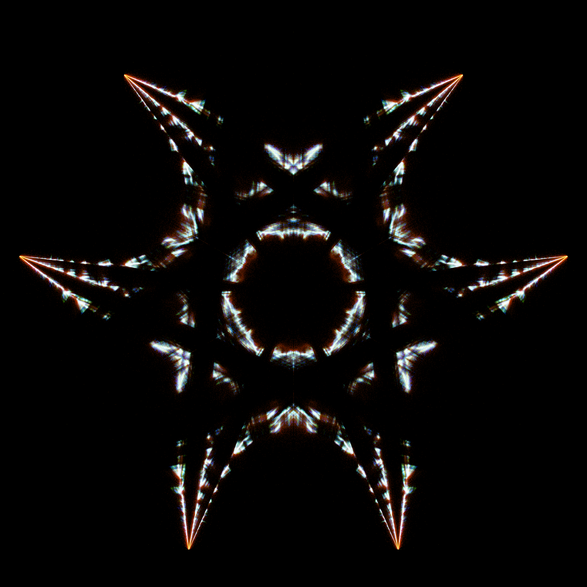

# stone, Linux version

Computes f(i,j) for i, j < dim, where (i, j, f(i,j)) are the losing positions
of a 3-pile game. A move removes t > 0 tokens from one pile, or the same t from
any two piles, or the same t from all three. Equivalently, f(i,j) is the
smallest k not excluded by earlier cells in its row, column and diagonal.
Output: `dim*dim` little-endian `int32`, row-major. Row 0 is the Wythoff
pairing; f is symmetric under every permutation of (i, j, f(i,j)).

Originally a 2012 Visual Studio project.

## Build

    cmake -S . -B build
    cmake --build build -j

## Run

    ./build/stone [dim] [output-file]     # defaults: 3000 res.bin

Threads: `OMP_NUM_THREADS` (on SMT CPUs, physical core count is fastest).
Tile size: `STONE_TILE` (default 64).

Memory is about 4*dim^2 bytes for the table plus 1.25*dim^2 bytes of state
(1.3 GB at 16000).

## GPU version

`stone_cuda` (same arguments, identical output) is built when CMake finds a
CUDA compiler. Without CMake:

    nvcc -O3 -std=c++17 -arch=sm_120 -o stone_cuda src/stone_cuda.cu

GPU memory is about 3.25*dim^2 bytes (the device keeps only the upper
triangle), so 16 GB fits dim up to about 65000. On an RTX 5060 Ti: 16000 in
0.65 s of GPU time, 32000 in 7.4 s; for large dim, writing the output file
dominates.

## Algorithm

See the header comment of `src/stone.cpp`: shift-free exclusion sets, one
search per triple using the permutation symmetry, searches starting at
max(i,j), and cache tiles processed in parallel wavefronts.

## Large tables (out of core)

    ./build/stone_strips run DIR N H [max-strips]
    ./build/stone_strips export DIR N H out.bin      # plain table, small N only

Strips of H rows are swept over the columns; the state (4 bit arrays per column
and diagonal) is streamed to a zstd-compressed file that the next strip reads.
Only j >= i is stored, about 15 GB at N = 128000. A killed run continues at the
last finished strip. N = 128000 was checked against independent older results.

After a power cut, `tools/resume.sh DIR N H MINFREE_GB` (put it, `keeper.sh`
and `stone_strips` in one directory) checks the files and continues.

## Pictures

The star is every losing position (i,j,k), in all 6 orders, as a direction on
the sphere seen along (1,1,1). Each point shines with light 1/r^2, red near,
green in the middle, blue far (14.3 billion points, N = 128000). More pictures,
and maps with names for the star's parts, are in `pictures/`. Each tool's
header comment has its usage:

- `stone_star`, `stone_starlight`: the star
- `stone_height`, `stone_crop`: f(x,y) from above, colour log2(k / max(x,y))
- `stone_bulbs`, `stone_diag`, `stone_tri`: perspective views and cuts
- `stone_zoom`: cuts x+y+z = s scaled by 1/s, with slices of a fixed percentage
- the `.py` scripts turn the raw output into PNG or video (NumPy, Pillow;
  GStreamer for video)

## Tests

    ctest --test-dir build --output-on-failure

- The 3000x3000 table must match a reference MD5.
- The first 200x200 cells are checked against a brute-force implementation of
  the game rules (`tests/naive.cpp`).

`tools/medial.cpp` checks the mediality identity on a table.
